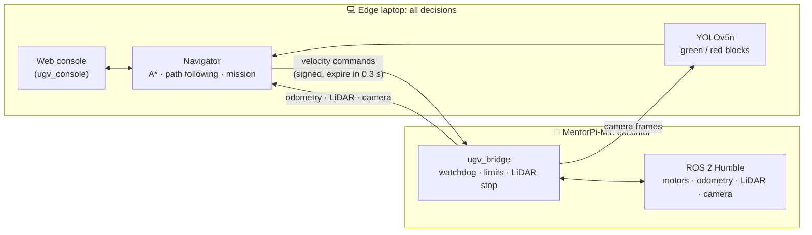
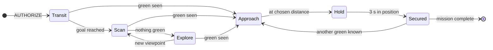
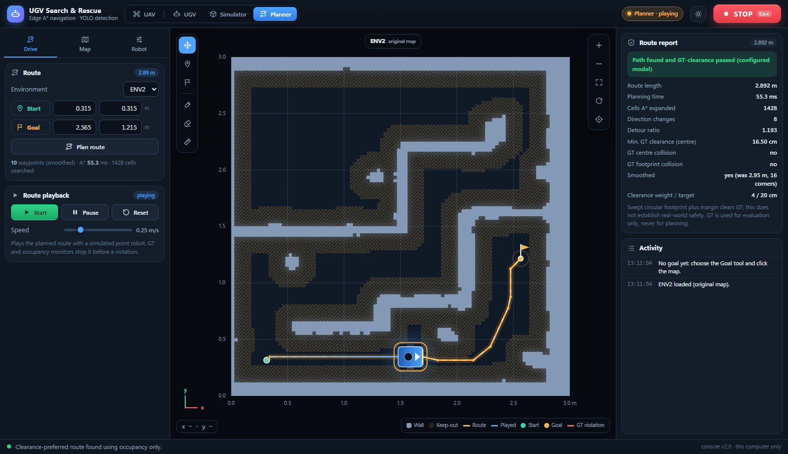
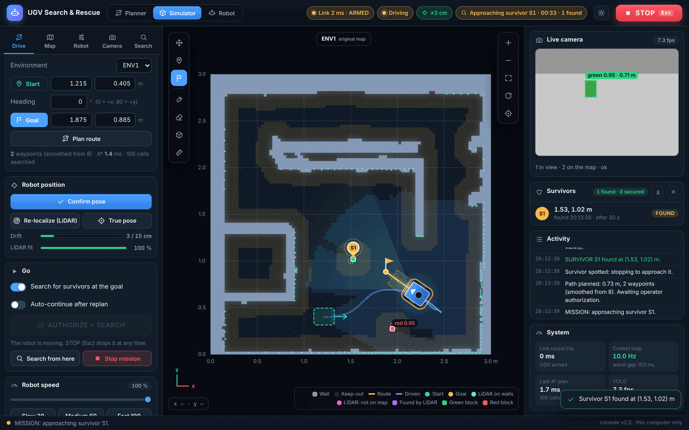
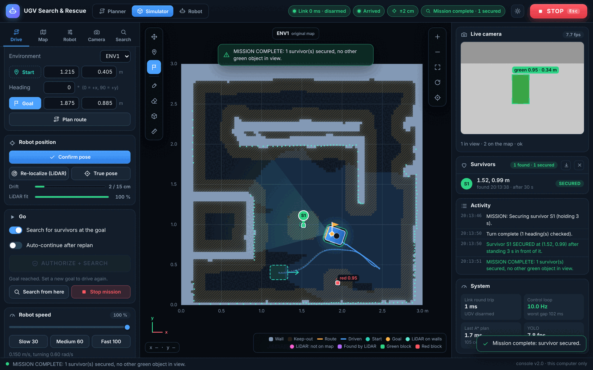

<div align="center">

# UGV A\* + YOLOv5 · Search & Rescue Console

**A ground robot that plans its own route with A\*, sees coloured objects with YOLOv5,<br>and drives to the survivor, controlled from one modern console on a laptop.**


*Simulator run (3.5× speed): drive to the goal, look around, spot the green object, approach, hold 3 s, **survivor secured**, mission complete.*

</div>

---

## What it does

| | |
|---|---|
| 🗺️ **A\* path planning** | Shortest safe route on a 3 × 3 m occupancy map (3 cm cells). The robot's real size is respected, routes prefer open space and are straightened without ever getting closer to walls. A plan takes about 15 ms. |
| 👁️ **YOLOv5 vision** | A YOLOv5n model finds **green** (survivor) and **red** (obstacle) blocks in the robot's camera. Each box is projected onto the floor and pinned on the map; red blocks are avoided by A\*. |
| 🚑 **Search mission** | The robot drives to your goal, looks around, goes to the **first green object it sees**, stops at the distance you chose, holds 3 s and marks it **secured**. No other green in sight: mission complete. |
| 🛰️ **LiDAR** | Stops for anything unexpected, adds it to the map, replans around it, and corrects the robot's position against the walls. |
| 🖥️ **Modern console** | Smooth 60 fps map, live camera with detection boxes, survivor list, activity log, dark and light theme. Runs in your browser, on your laptop only. |
| 🛑 **Safety first** | Nothing moves without **AUTHORIZE**. **Esc = STOP**. The robot stops by itself if the link, the laptop or the console page goes away. |

## How it fits together

All thinking happens on the laptop. The robot only runs a small bridge that passes sensor data up and
checked velocity commands down.



### The search mission



## Screenshots

| Planner: A\* route on ENV2 | Mission: approaching survivor S1 |
|---|---|
|  |  |

<div align="center"></div>

## Quick start

You need **Python 3.11, 3.12 or 3.13** on Windows, macOS or Linux. No robot is needed to try it.

```bash
git clone https://github.com/Aizu-x/UGV_A-Star-YOLOV5.git
```
```bash
cd UGV_A-Star-YOLOV5
```
```bash
python -m venv .venv
```
```bash
.venv\Scripts\python.exe -m pip install -r requirements.txt -r requirements-yolo.txt
```
```bash
.venv\Scripts\python.exe nav_main.py gui
```

On macOS / Linux use `.venv/bin/python` instead of `.venv\Scripts\python.exe`.
On Windows you can also double-click **`START_CONSOLE.bat`**. To get the newest version later: `git pull`
(or double-click **`UPDATE.bat`**).

### Try it in 60 seconds (no robot)

1. Top bar: **Simulator**, then **Start simulator** (Drive tab).
2. Tool **Start**: click the map where the robot stands, drag to set its heading, **Confirm pose**.
3. **Camera** tab: switch **Camera + YOLO** on, then **Place / remove blocks** and drop a green block.
4. Tool **Goal**: click the map. Tick **Search for survivors at the goal**.
5. **AUTHORIZE + SEARCH**, confirm, and watch. **Esc** stops at any time.

Full instructions: **[User guide](docs/USER_GUIDE.md)** · Real robot: **[Robot setup](docs/ROBOT_SETUP.md)**

## Project layout

| Folder | Runs on | What it is |
|---|---|---|
| `ugv_planner/` | laptop | The A\* planner, occupancy grid, collision and clearance checks |
| `ugv_nav/` | laptop | Localization, path following, safety, LiDAR matching, YOLO mapping, search mission |
| `ugv_console/` | laptop | The console: Python backend and the web page (`web/`) |
| `ugv_bridge/` | robot | The only program on the MentorPi: authenticated link, watchdog, ROS 2 topics |
| `third_party/wro_yolo/` | laptop | YOLOv5n model (ONNX) for green / red blocks |
| `data/` | laptop | Three arena maps (ENV1-3): occupancy grid + ground truth |
| `config/` | laptop | `navigation.toml`: robot size, speeds, limits |
| `tests/` | laptop | 186 automated tests |
| `docs/` | | Guides and technical notes |

## Safety design

- **Operator authorization**: every autonomous drive needs a two-step confirmation in the console.
- **Two independent layers**: the laptop checks the route, position confidence and LiDAR; the robot bridge
  checks speed limits and its own LiDAR stop zone, and is the only thing that writes to the motors.
- **Watchdog**: commands expire after 0.3 s. Wi-Fi loss, a closed laptop or a closed console page stops the robot.
- **Authenticated link**: every message is signed (HMAC-SHA256) with a shared key that never leaves your devices.
- **Position confidence**: if the estimated drift exceeds 15 cm, the robot stops and asks to be re-localized.

## Project status

| Area | Status |
|---|---|
| A\* planning, smoothing, mission logic, vision filters, console | ✅ 186 automated tests + browser end-to-end runs |
| Full loop in the built-in simulator (real bridge code, simulated robot, LiDAR and camera) | ✅ working |
| Link to the real MentorPi (authentication, odometry, IMU, LiDAR received) | ✅ verified |
| Autonomous driving and YOLO on the real robot | 🔧 in progress, **not yet verified** |

Details: **[Testing](docs/TESTING.md)** · How each part works: **[How it works](docs/HOW_IT_WORKS.md)**

## Documentation

| Guide | For |
|---|---|
| [User guide](docs/USER_GUIDE.md) | Using the console: planner, simulator, real robot, search mission, settings |
| [Robot setup](docs/ROBOT_SETUP.md) | Putting the bridge on the MentorPi and connecting, step by step |
| [How it works](docs/HOW_IT_WORKS.md) | Architecture, A\*, vision, mission, protocol, safety rules |
| [Testing](docs/TESTING.md) | What was tested, how, and what is still open |

## Credits

Final-year project by **Abbas Faisal Modhaffar**: A\* navigation, operator console and robot integration.
The YOLOv5n red / green block detector in `third_party/wro_yolo/` was trained by a project teammate.
Robot platform: HiWonder MentorPi-M1 (Raspberry Pi 5, ROS 2 Humble).
