<p align="center">
  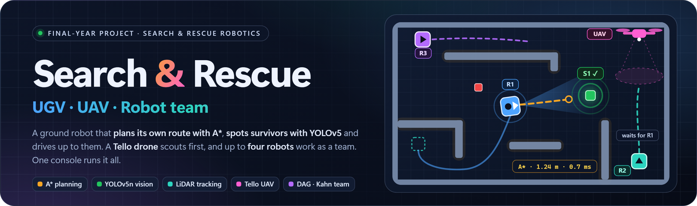
</p>

<div align="center">

<h3>🎓 The team</h3>

<table>
  <tr>
    <td align="center" valign="top" width="190"><br><b>Abbas Modhaffar</b><br><sub>UGV / UAV navigation<br>A* path planning<br>Console app</sub></td>
    <td align="center" valign="top" width="190">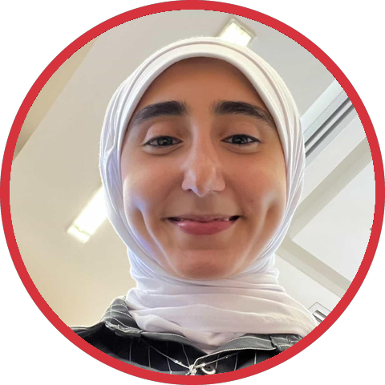<br><b>Sara Salman</b><br><sub>Team Leader<br>YOLOv5 · ERFNet<br>ORB-SLAM3</sub></td>
    <td align="center" valign="top" width="190">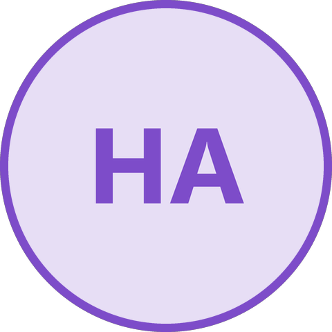<br><b>Haneen Albadry</b><br><sub>DAG scheduler<br>Kahn's algorithm</sub></td>
    <td align="center" valign="top" width="190">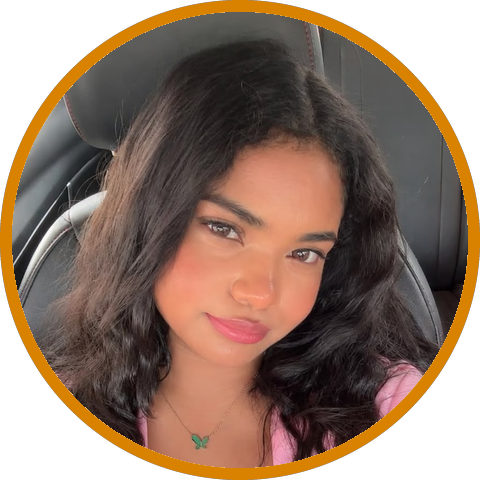<br><b>Haya Alhajraf</b><br><sub>Kahn's algorithm<br>Video editor</sub></td>
  </tr>
</table>

</div>

<p align="center">
  
  
  
  
  
  
  
  
</p>

<p align="center">
  <a href="https://github.com/Aizu-x/FYP-Search-And-Rescue/releases/latest"></a>
</p>

<p align="center">
  <b>A ground robot that plans its own route with A*, spots survivors with YOLOv5 and drives up to them.</b><br>
  A Tello drone scouts first, up to four robots work as a team, and one console on a laptop runs it all.
</p>

<p align="center">
  <a href="https://github.com/Aizu-x/FYP-Search-And-Rescue/releases/latest"><b>Download</b></a> ·
  <a href="#-quick-start"><b>Quick start</b></a> ·
  <a href="#-what-it-does"><b>Features</b></a> ·
  <a href="#-screenshots"><b>Screenshots</b></a> ·
  <a href="#-a-team-of-robots"><b>Team</b></a> ·
  <a href="#-how-it-fits-together"><b>How it works</b></a> ·
  <a href="#-documentation"><b>Docs</b></a>
</p>

<p align="center">
  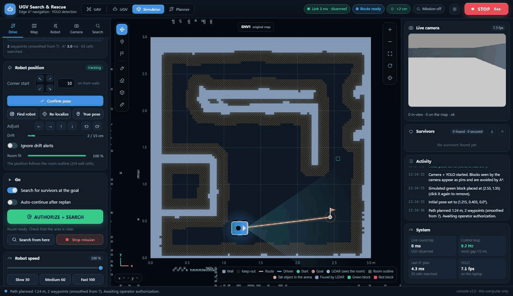
  <br>
  <sub><i>Search mission in the built-in simulator (2.5× speed): drive to the goal, look around, spot the green block, approach, hold 3 s, <b>survivor secured</b>.</i></sub>
</p>

<div align="center">

| 🤖 **4** | ⚡ **~31 ms** | 🛑 **0.3 s** | 🧪 **426** |
|:-:|:-:|:-:|:-:|
| robots in the team simulator | YOLOv5n per image on a CPU | until a motion command expires on the robot | automated tests |

</div>

---

## ✨ What it does

| | |
|---|---|
| 🚁 **UAV scouts first** | Fly a Tello from the same console: live camera, **battery and altitude**, **W A S D** to move, **arrow keys** for height and turning, two-step take-off, **Esc = land**. Every flight is filmed and saved as an MP4. A simulated drone is built in for practice. |
| 🧭 **Planned flight** | Write a flight plan step by step (*Up 20 cm, Turn right 360°, Forward 40 cm, Land*) or let the console **copy a flight you flew by hand**. The drone flies it by itself after you confirm; any key takes the controls back. |
| 🗺️ **A\* path planning** | Shortest safe route on the arena's occupancy map (3 cm cells, stretched to the real size of your field). The robot's real size is respected, routes prefer open space and are straightened without ever getting closer to walls. |
| 👁️ **YOLOv5 vision** | A YOLOv5n model finds **green** (survivor) and **red** (obstacle) blocks in the robot's camera. Each box is projected onto the floor and pinned on the map; red blocks are avoided by A\*. |
| 🚑 **Search mission** | The robot drives to your goal, looks around, goes to the **first green block it sees**, stops at the distance you chose, holds 3 s and marks it **secured**. |
| 👥 **Team of robots** | Up to **four simulated robots**, each with its own colour, start, goal and camera. A task graph and **Kahn's algorithm** decide who drives when, and a robot that sees a survivor drives up to it. [More below](#-a-team-of-robots). |
| 🛰️ **LiDAR tracking** | The LiDAR sits higher than the arena walls, so it sees the room instead. The console draws the room's outline and follows the robot's true movement in it: no wheel drift, and a robot that is carried elsewhere is found again. |
| 📍 **Knows where it is** | Stand the robot in a corner one block length from both walls and click that corner, or press **Find robot**. You can still nudge the position by hand. |
| 🎥 **Mission video** | Every search mission is filmed with the robot's camera and saved as an MP4, with the time, what the robot is doing, survivors found and the YOLO boxes on the picture. |
| 🖥️ **Modern console** | Smooth 60 fps map, live camera with detection boxes, survivor list, activity log, dark and light theme. Runs in your browser, on your laptop only. |
| 🛑 **Safety first** | Nothing moves without **AUTHORIZE**. **Esc = STOP**. The robot stops by itself if the link, the laptop or the console page goes away. |

## 📸 Screenshots

| **Planner**: an A\* route on ENV2, played back | **Search mission**: approaching survivor S1 |
|:-:|:-:|
|  |  |
| **Live LiDAR tracking**: the grey outline is the room | **Mission complete**: survivor secured |
| 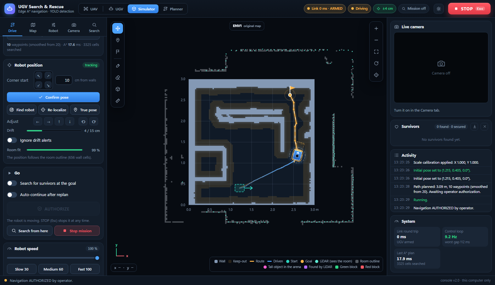 |  |
| **UAV, manual control**: camera, battery, altitude, keys | **UAV, planned flight**: step 2 of 4 under way |
| 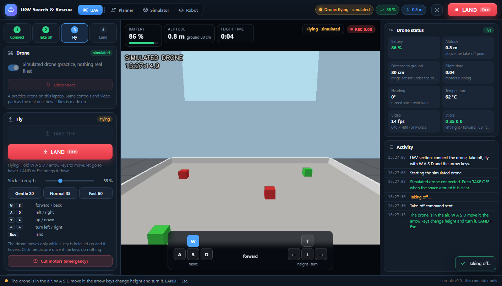 | 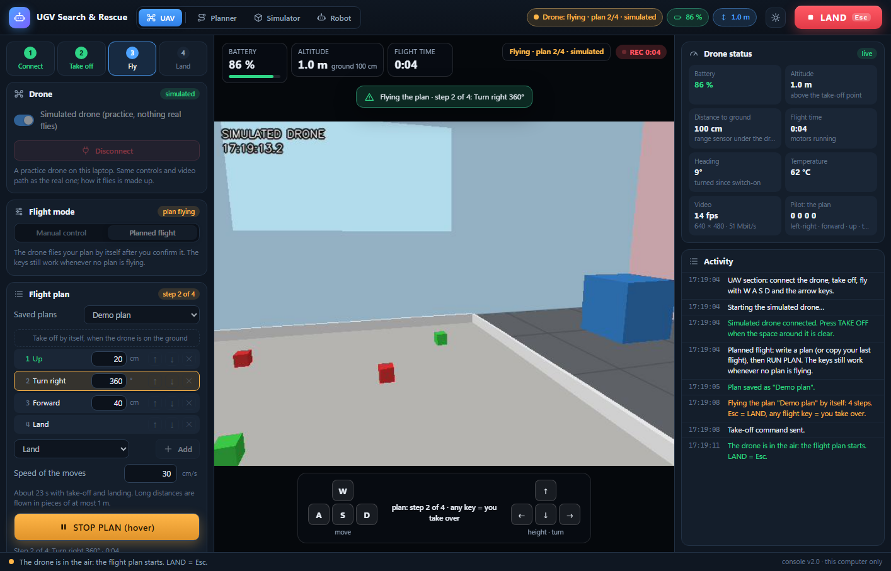 |

<sub>The drone pictures show the built-in simulated drone above the arena.</sub>

## 👥 A team of robots

Choose **2, 3 or 4** robots in the simulator. Each gets its own colour, label, start, goal, route and camera, and
the order they drive in comes from a **task graph** (a DAG) ordered with **Kahn's algorithm**, from the team's
scheduler in `DAG_scheduler/`.

<p align="center">
  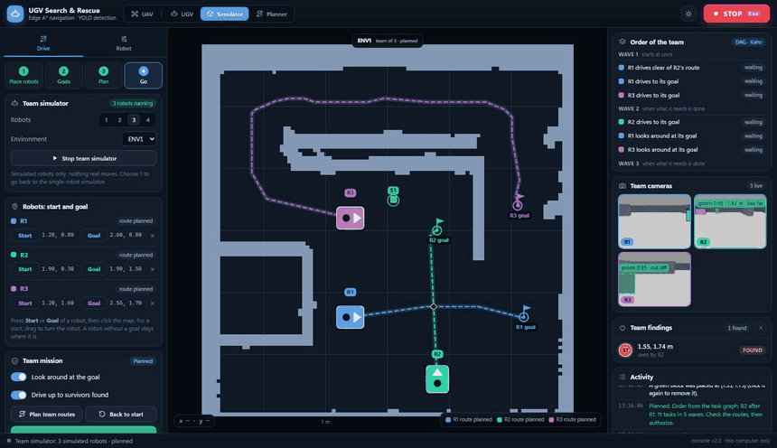
  <br>
  <sub><i>Team run (5× speed): R1 and R3 start at once, R2 waits until R1 is clear of its route. After looking around, R2 drives to survivor S1 and secures it.</i></sub>
</p>

- **Who waits for whom.** Two robots whose routes come close get an order: the second starts as soon as the first is
  *clear of its route*, not only when it has arrived. Robots that are not in each other's way start together.
- **Trouble does not end the mission.** A robot that stops for something it can get over plans again and drives on.
  One that stops for good is driven around where there is a way.
- **Survivors.** A robot that has seen a survivor drives up to it after its own tasks, faces it and secures it, one
  robot per survivor, and only once its way is clear of what the others still have to drive.
- **Cameras that respect walls.** Each robot's camera sees the arena's walls, and a block behind a wall stays hidden.

The task graph of the run above. A task starts as soon as everything it needs has succeeded:

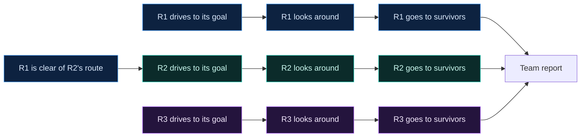

The team is a simulator feature: [Team simulator guide](docs/TEAM.md).

## 🚀 Quick start

### Easiest: the Windows package (nothing to install)

1. Download **`FYP-Search-And-Rescue-v2.0-Windows.zip`** from the [latest release](https://github.com/Aizu-x/FYP-Search-And-Rescue/releases/latest).
2. Unzip it (right-click > *Extract All*).
3. Double-click **`FYP_SRM.exe`**. The console opens in your browser.

Everything it needs is inside the folder, Python included. Windows may say *"Windows protected your PC"* because
the program is not signed: *More info* > *Run anyway*. The file `START HERE.txt` in the folder has the first steps.

### From the source code (Windows, macOS, Linux)

You need **Python 3.11 or newer**. No robot or drone is needed to try it.

```bash
git clone https://github.com/Aizu-x/FYP-Search-And-Rescue.git
```
```bash
cd FYP-Search-And-Rescue
```
```bash
python -m venv .venv
```
```bash
.venv\Scripts\python.exe -m pip install -r requirements.txt -r requirements-yolo.txt
```
```bash
.venv\Scripts\python.exe nav_main.py gui
```

On macOS / Linux use `.venv/bin/python` instead of `.venv\Scripts\python.exe`.
On Windows you can also double-click **`START_CONSOLE.bat`**, and **`UPDATE.bat`** gets the newest version (`git pull`).

**No terminal at all (Windows):** double-click **`FYP_SRM.exe`**. It finds the Python by itself (the one named in
`FYP_SRM.ini`, else the folder's `.venv`, else the one on the PATH), starts the console and shows an error box if
something is wrong ([more](MERGE_NOTES.md#the-exe)).

<details>
<summary><b>🤖 Try a search mission in 60 seconds</b> (no robot)</summary>

1. Top bar: **Simulator**, then **Start simulator** (Drive tab).
2. **Corner start**: click a corner in the *Robot position* card, then **Confirm pose**.
3. **Camera** tab: switch **Camera + YOLO** on, then **Place / remove blocks** and drop a green block.
4. Tool **Goal**: click the map. Tick **Search for survivors at the goal**.
5. **AUTHORIZE + SEARCH**, confirm, and watch. **Esc** stops at any time.

</details>

<details>
<summary><b>🚁 Try the drone in 60 seconds</b> (no drone)</summary>

1. Top bar: **UAV**. Switch **Simulated drone** on, then **Start simulated drone**.
2. **TAKE OFF**, confirm.
3. Hold **W A S D** to move, **↑ ↓** for height, **← →** to turn. Let go: it hovers.
4. **Esc** lands. The flight video is in `Videos\UAV footage`.
5. Planned flight: switch **Flight mode** to **Planned flight**, add *Up 20*, *Turn right 360*, *Forward 40*, *Land*, press **RUN PLAN**.

</details>

<details>
<summary><b>👥 Try a team in 60 seconds</b> (no robots)</summary>

1. Top bar: **Simulator**. In *Robots in the simulator* press **3**.
2. **Start team simulator**.
3. Press **Goal** of R1 and click the map; do the same for R2 and R3 (the tool moves on by itself).
4. Optional: card *Test blocks*, colour **Green**, then click a free spot near a goal: a survivor to find.
5. **Plan team routes**: the card *Order of the team* shows who waits for whom.
6. **AUTHORIZE + START TEAM**, confirm, and watch. **Esc** stops every robot.

</details>

Full instructions: **[User guide](docs/USER_GUIDE.md)** · Drone: **[UAV guide](docs/UAV.md)** · Team: **[Team simulator](docs/TEAM.md)** · Real robot: **[Robot setup](docs/ROBOT_SETUP.md)**

## 🧩 How it fits together

All thinking happens on the laptop. The robot only runs a small bridge that passes sensor data up and
checked velocity commands down.

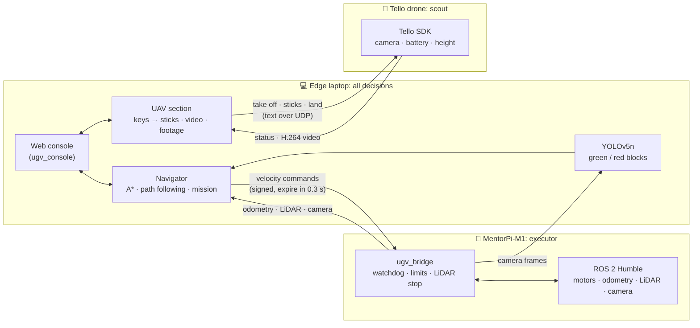

### The search mission

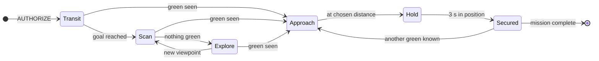

## 🔗 Combined system: DAG scheduler + ORB-SLAM3 + A\* + YOLOv5n

A teammate's integration package is part of this repository (`DAG_scheduler/`). It checks three parts of the team
project in one run, in the right order: Kahn's algorithm releases a task when the tasks it depends on have succeeded.

```text
ready recording -> ORB-SLAM3 ---------------------+
saved occupancy -> this project's A* -------------+-> combined report
saved example images -> YOLOv5n inference ---------+
```

- It calls **this project's own A\* and YOLOv5n code** (not copies of it), so it checks the version in this repository.
- The detector is **YOLOv5n ONNX**. No model was converted or retrained.
- ORB-SLAM3 results are imported from saved exports; a fresh ORB run needs Linux / WSL. Turning an ORB map into a
  navigation map is not part of this package.
- The full ORB assets (`ORB_handoff/`, about 700 MB) are **not stored in this repository**: they are installed from
  the team's archives ([Run on the edge computer](EDGE_SETUP.md)). A reference copy of the ORB-SLAM3 source with
  sample keyframes and saved results, and the ERFNet model with its inputs and outputs, is in
  [`perception/`](perception/README.md).
- Run it: double-click **`RUN_COMBINED.cmd`** (Windows) or `bash run_combined.sh` (Linux).
  Expected last line: `Status: COMPONENT_INTEGRATION_SUCCEEDED`.

Guides: **[Run on the edge computer](EDGE_SETUP.md)** · **[Connections](COMBINED_INTEGRATION.md)** ·
**[Verification](verification/COMBINED_RESULTS.md)** · **[What was merged and changed](MERGE_NOTES.md)**

## 📁 Project layout

| Folder | Runs on | What it is |
|---|---|---|
| `ugv_planner/` | laptop | The A\* planner, occupancy grid, collision and clearance checks |
| `ugv_nav/` | laptop | Localization, room-based LiDAR tracking, path following, safety, YOLO mapping, search mission, team simulator |
| `ugv_console/` | laptop | The console: Python backend and the web page (`web/`) |
| `uav/` | laptop | The UAV section: link to the Tello, flight plans, video receiver and recorder, simulated drone |
| `ugv_bridge/` | robot | The only program on the MentorPi: authenticated link, watchdog, ROS 2 topics |
| `third_party/wro_yolo/` | laptop | YOLOv5n model (ONNX) for green / red blocks |
| `data/` | laptop | Three arena maps (ENV1-3): occupancy grid + ground truth |
| `config/` | laptop | `navigation.toml`: robot size, speeds, limits |
| `tests/` | laptop | 426 automated tests |
| `docs/` | | Guides and technical notes |
| `DAG_scheduler/` | laptop | Combined system: Kahn scheduler, ORB / A\* / YOLO adapters, its own 62 tests |
| `scripts/`, `assets/`, `verification/` | laptop | Combined system: ORB asset installer and record, combined check, recorded results |
| `perception/` | laptop | Optional reference: ORB-SLAM3 source, sample keyframes and saved results; the ERFNet model, arena photos, masks and grids. About 110 MB, so it is left out of ZIP downloads and the Windows package: clone the repository to get it |
| `launcher/` | laptop | Source of `FYP_SRM.exe` (the no-terminal starter), its picture `icon.png` and the build script |

## 🛡 Safety design

- **Operator authorization**: every autonomous drive needs a two-step confirmation in the console.
- **Two independent layers**: the laptop checks the route, position confidence and LiDAR; the robot bridge
  checks speed limits and its own LiDAR stop zone, and is the only thing that writes to the motors.
- **Watchdog**: commands expire after 0.3 s. Wi-Fi loss, a closed laptop or a closed console page stops the robot.
- **Authenticated link**: every message is signed (HMAC-SHA256) with a shared key that never leaves your devices.
- **Position confidence**: if the estimated drift exceeds 15 cm, the robot stops and asks to be re-localized.
  You can switch this one alert off in the console (*Ignore drift alerts*, with a confirmation); STOP, the LiDAR
  stop zone, link loss and broken odometry keep stopping the robot either way.
- **No guessing**: the LiDAR may place the robot by itself only on a strong, unambiguous fit; otherwise you choose.
- **The drone**: take-off needs a confirmation, **Esc lands**, letting go of the keys means hover, and the drone is
  brought down when the page, the console program or the radio link goes away. One machine moves at a time.
  A flight plan is shown in full before it may start, and any flight key stops it and gives the controls back.
- **The team**: one authorization for the order shown; if the order changes, it has to be given again. Esc stops
  every robot, and a last check stops any robot that comes too close to another.

## 📊 Project status

| Area | Status |
|---|---|
| A\* planning, smoothing, mission logic, vision filters, console | ✅ 426 automated tests + browser end-to-end runs |
| Full loop in the built-in simulator (real bridge code, simulated robot, LiDAR and camera) | ✅ working |
| Link to the real MentorPi (authentication, odometry, IMU, LiDAR) | ✅ tested on the real robot |
| Autonomous driving, search mission and YOLO on the real robot | ✅ tested on the real robot |
| Room-based LiDAR tracking, Find robot, real field size | ✅ tested on the real robot |
| Mission video | ✅ working |
| UAV section, manual control: keys, live picture, battery / altitude, footage | ✅ flown with a real Tello |
| UAV section, planned flight: written plans and copied manual flights | ✅ flown with a real Tello |
| Team simulator: 2 to 4 robots ordered by the task graph, survivors approached and secured | ✅ 82 tests and browser runs (a simulator feature) |
| Combined system: scheduler + saved ORB results + this A\* + this YOLOv5n | ✅ its 62 tests and full runs (Windows, Python 3.14) |

Details: **[Testing](docs/TESTING.md)** · How each part works: **[How it works](docs/HOW_IT_WORKS.md)**

## 📚 Documentation

| Guide | For |
|---|---|
| [User guide](docs/USER_GUIDE.md) | Using the console: planner, simulator, real robot, search mission, settings |
| [UAV guide](docs/UAV.md) | The drone section: keys, planned flight, readings, footage, troubleshooting |
| [Team simulator](docs/TEAM.md) | 2 to 4 robots: placing them, goals, the order from the task graph, survivors, limits |
| [Robot setup](docs/ROBOT_SETUP.md) | Putting the bridge on the MentorPi and connecting, step by step |
| [How it works](docs/HOW_IT_WORKS.md) | Architecture, A\*, vision, mission, protocol, safety rules |
| [Testing](docs/TESTING.md) | What was tested and how |
| [Run on the edge computer](EDGE_SETUP.md) | Combined system: setup and running the component check |
| [Connections](COMBINED_INTEGRATION.md) | Combined system: how the modules connect |
| [Perception reference](perception/README.md) | ORB-SLAM3 and ERFNet: what went in and what came out (optional) |
| [Merge notes](MERGE_NOTES.md) | What was merged, what was changed to make it fit, `FYP_SRM.exe` |

## 🙏 Credits

The team is shown at the top of this page.
The YOLOv5n red / green block detector in `third_party/wro_yolo/` was trained by Sara Salman.
The DAG scheduler, its adapters and the ORB-SLAM3 handoff in `DAG_scheduler/` come from the team's
combined-integration package; ORB-SLAM3 and its bundled libraries keep their own licences
(see [THIRD_PARTY_NOTICES.md](THIRD_PARTY_NOTICES.md)).
The reference folder `perception/` builds on [ORB-SLAM3](https://github.com/UZ-SLAMLab/ORB_SLAM3) (GPL-3.0) and on
[ERFNet](https://github.com/Eromera/erfnet_pytorch) by Eduardo Romera et al., whose code is licensed CC BY-NC 4.0
(non-commercial use).
Robot platform: HiWonder MentorPi-M1 (Raspberry Pi 5, ROS 2 Humble). Drone: Tello (Ryze / DJI), Tello SDK 1.3.

**Licence:** the project's own code is released under the [MIT License](LICENSE). Third-party code and models keep
their own licences: ORB-SLAM3 (GPL-3.0), ERFNet (CC BY-NC 4.0, non-commercial) and the Ultralytics YOLOv5 framework
the detector was trained with (AGPL-3.0). See [THIRD_PARTY_NOTICES.md](THIRD_PARTY_NOTICES.md).
