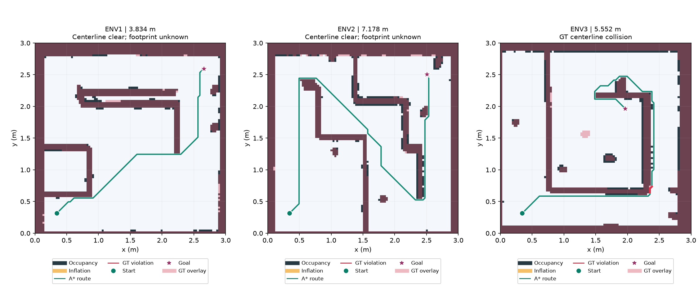

# Executed results

Generated from the six supplied arrays by `python tools/reproduce.py`. Timings are single-run wall-clock measurements, not real-time guarantees.

## Baseline: 8-way, unknown footprint, zero margin

| Metric | ENV1 | ENV2 | ENV3 |
|---|---:|---:|---:|
| Path found | True | True | True |
| Path length (m) | 3.834 | 7.178 | 5.552 |
| Planning time (ms) | 313.773 | 532.955 | 499.393 |
| Expanded nodes | 2510 | 5202 | 4812 |
| Turns | 10 | 13 | 20 |
| Detour ratio | 1.181 | 2.334 | 2.401 |
| Minimum GT center clearance (cm) | 1.500 | 1.500 | 0.000 |
| GT centerline collision | False | False | True |
| Simulation outcome | arrived | arrived | blocked |

| GT validation | ENV1 | ENV2 | ENV3 |
|---|---|---|---|
| Status | Safety undetermined: footprint not verified | Safety undetermined: footprint not verified | Path found but GT collision/clearance failed |

The shortest-distance ENV3 route is valid against occupancy but intersects GT. The new preflight gate blocks dispatch. ENV1/ENV2 have only 1.5 cm centerline clearance; this is not a physical robot safety claim.

## Sensitivity experiment: arbitrary radius 0.10 m, margin 0.02 m

These are test parameters, **not MentorPi measurements**, and remain unverified.

| Metric | ENV1 | ENV2 | ENV3 |
|---|---:|---:|---:|
| Path found | True | True | True |
| Path length (m) | 3.940 | 7.986 | 6.272 |
| Planning time (ms) | 267.446 | 369.100 | 279.331 |
| Expanded nodes | 2120 | 3240 | 2539 |
| Turns | 9 | 22 | 23 |
| Detour ratio | 1.214 | 2.596 | 2.713 |
| Minimum GT center clearance (cm) | 13.500 | 13.500 | 10.607 |
| Minimum footprint clearance (cm) | 3.500 | 3.500 | 0.607 |
| GT footprint collision | False | False | False |
| Simulation outcome | arrived | arrived | blocked |

ENV3 clears the configured physical disk but fails its additional 2 cm margin. That is correctly reported as a clearance failure; it is not a centerline collision in this experiment.

## Verification scope

See `verification/tests.txt` for the executed suite and `verification/runtime.json` for the runtime. The GUI callback test creates actual Tk widgets, switches all environments, changes endpoints/footprints, replans during motion, tests edits and exports, and captures callback exceptions. It skips explicitly if a display is unavailable.

The Windows interface was also visually inspected and its Start/Pause controls exercised through desktop UI input. Ubuntu and physical MentorPi/ROS2 execution were not tested. Array shape/coordinate conventions were checked; physical registration cannot be established from `.npy` alone.

The analytical no-route cases and inflation-induced passage closure are in `tests/test_system.py`. Source files are preserved and identified in `data_manifest.json`.
