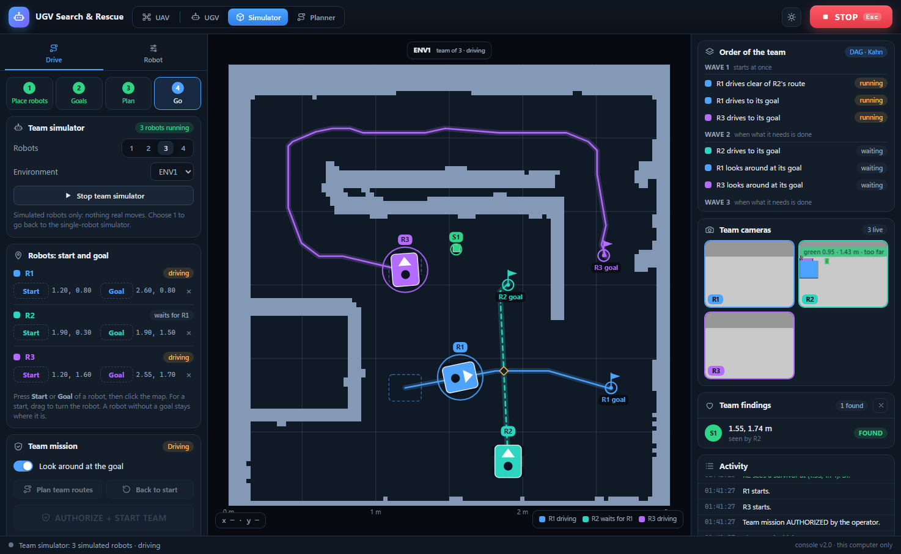
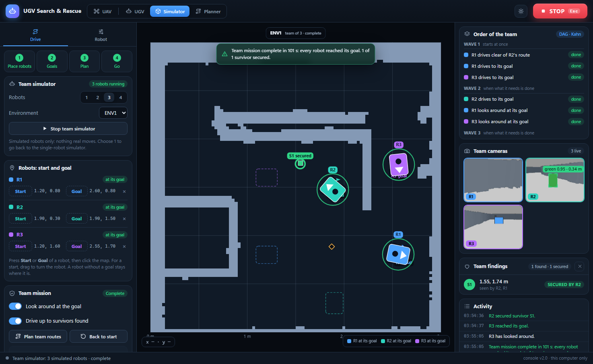

# Team simulator: up to four robots

The simulator can run **2, 3 or 4 simulated robots** in one arena. Each robot has its own colour, label,
starting place, goal, route, state and camera. The robots work as a team: the order they drive in is worked
out from a task graph (a **DAG**) with **Kahn's algorithm**, the one from the team's scheduler in
`DAG_scheduler/`.

**Simulator only.** A team is built from simulated robots and nothing else. No command of the team simulator
connects to a real robot, and it is only offered in Simulator mode. With one robot the simulator is exactly
what it was before.

*R1 (blue) and R3 (purple) drive. R2 (teal) waits until R1 is clear of its route: the diamond marks where the
two routes cross. Top right: the tasks of the team, in the waves Kahn's algorithm puts them in.*

## Try it

1. Top bar: **Simulator**.
2. Card *Robots in the simulator*: press **2**, **3** or **4**. The team view opens. Every robot already has a
   starting place. The arena is chosen with **Environment** in the card *Team simulator*.
3. To move a robot: press its **Start** button, click the map, and drag to turn it. Right-click when done.
4. **Start team simulator**.
5. Press **Goal** of R1 and click the map; the tool moves on to the next robot by itself.
   A robot without a goal stays where it is, and the others drive around it. The **×** next to a goal removes it.
6. **Plan team routes**. The routes appear, and the card *Order of the team* shows who waits for whom.
7. **AUTHORIZE + START TEAM**, read the summary, confirm. **Esc** (STOP) stops every robot at any time.
8. To see a rescue: before step 6, card *Test blocks*, colour **Green**, **Place / remove blocks on the map**, and
   click a free spot a robot will see from its goal. That robot looks around, drives up to the block and secures it.

To go back to the single-robot simulator, choose **1** robot.

**The tabs in the team view.** *Drive* is the team panel. *Robot* keeps the settings a team uses: the robot's
footprint, the A\* planner and the real field size. *Map*, *Camera* and *Search* belong to the single robot and
are hidden while a team is chosen; the team's cameras and findings are on the right of the map.

## What the task graph and Kahn's algorithm do

Two robots are *in each other's way* when their routes come closer than a safe distance (twice the planning
radius plus 8 cm). For every such pair one robot has to go first. That is a dependency, and all dependencies of
the team form a graph without circles.

| Situation | What happens |
|---|---|
| The routes stay apart | No dependency: both robots start together. |
| The routes cross or run close | One goes first (the lower number, unless another rule decides). The other starts as soon as the first is **clear of its route**, not only when it has arrived. |
| A robot stands on another one's route | It has to drive away first: that order is forced. |
| A robot's goal lies on another one's route | The other has to pass before the robot parks there: forced as well. |
| Each blocks the other (two robots that would swap places) | Refused, with the reason. Move a start or a goal. |
| Three or more robots that wait for each other in a circle | Kahn's algorithm finds no order: refused. |
| A robot stops for good while others wait for it | Its own tasks fail. The others still go if they can: see *When a robot stops* below. |

The tasks of a robot `R1` are `r1_clear_r2` (it has driven clear of R2's route; one for every robot that waits
for it), `r1_arrive` (it reached its goal) and `r1_scan` (it looked around). `team_report` needs every robot's
last task. A task is released when all the tasks it needs have succeeded, which is Kahn's algorithm one step at
a time.

The scheduler in `DAG_scheduler/` runs one task at a time, each in its own process. That fits a pipeline of
programs, not several robots moving at once. So the team simulator uses the scheduler's Kahn function and its
task type for the order, and a small in-process part with the same rules for the driving
(`LiveGraph` in `ugv_nav/team_plan.py`).

## How the routes are planned

- Every robot's own navigator plans its route with the usual A\*, on its own copy of the map. In that copy the
  places where the other robots stand and will park are drawn as obstacles.
- If that leaves a robot no way through, its route may pass a place another robot will have left, or has not
  reached yet. The order of the team then has to make that true, and the rules above check it.
- Up to four candidate routes per robot are tried. The combination with the fewest such liberties that can be
  put in an order is used.

## The arena, and where a robot thinks it is

- **The arena is the map you see.** The team drives in the operator map as it is drawn, with your edits. A wall
  on the page is a wall for the robots, and there are no walls the page does not show. (The single-robot
  simulator drives in the data set's "true" arena instead, which lets it show what a wrong map does.)
- **Exact odometry.** A simulated team robot knows exactly where it is. The scale calibration of the real robot
  (*X scale* / *Y scale* in the Robot tab) is not applied to it: that calibration corrects real wheels, and a
  simulated robot that believed it would think it is somewhere it is not and drive into a wall.

## When a robot stops

A robot that stops does not end the mission for the others.

| What happened | What the team does |
|---|---|
| A robot stops for something it can get over (an obstacle, a lost line, no headway for 8 s) | It waits a moment, plans a new route from where it stands and drives on. Up to 3 new tries. |
| A robot stops for good (operator STOP of that robot, too close to another, 3 tries used up), **out of the way** of the robots waiting for it | The waiting robots start as if it had passed. |
| It stops for good **on the route** of a robot waiting for it | When it is that robot's turn, it plans another way around the stopped one and takes it. |
| There is no way around it | The waiting robot does not start. Its row says *cannot start* and why. |

A robot that has stopped for good is an obstacle where it stands; the place it started from and its goal are
free again for the others. At the end the banner says who reached its goal, who stopped and why. Every robot's
row in the team panel shows its reason in red. **Plan team routes** again to go on from where the robots stand.

A robot that keeps getting a new route from the same place without moving on (its own safety stop refuses a gap
the planner took for wide enough) gives up after 4 such routes, instead of trying for ever.

## Survivors

A green block is a survivor. What the team does with one:

1. **Seen.** A robot's camera sees it (while driving, or while looking around at its goal). It goes into
   *Team findings* with the robots that saw it and is pinned on the map as S1, S2, ...
2. **Approached.** With *Drive up to survivors found* on, a robot that has seen a survivor itself drives up to
   it after its other tasks: to a free spot one gap (25 cm) in front of it, from which it can see it.
3. **Secured.** There it turns to face the survivor and stands for 3 seconds. The list then says
   *secured by R2*, and the pin on the map says *S1 secured*.

Rules that keep this safe and orderly:

- One robot per survivor: the first that is free to go takes it, the others leave it alone.
- A robot only sets off when its way to the survivor is clear of everything the other robots still have to
  drive. Until then its row says *waits to go to S1*. After 90 seconds of waiting it leaves that survivor.
- The robots that already stand somewhere (at a goal, at a survivor, stopped) are obstacles for its route.
- A survivor it cannot get to (no free spot, no safe route) is left as *found*; that does not fail the mission.
- **A survivor in the way.** A block in a narrow passage closes it, for a survivor as for any block. A robot
  that finds its way to its goal closed, and has found a survivor, goes to that survivor instead of giving up.
  The mission then ends as complete, and the banner says so: *R2 reached its goal; R1 stopped at a survivor
  on its way.*
- The task graph has one more task per robot for this, `r1_rescue`, after `r1_scan`. Switching the option
  changes the plan, so it has to be planned and authorized again.

With the switch off the robots only report survivors, as before.

*R2 (teal) has driven up to survivor S1 and secured it. The camera pictures on the right show the walls of the
arena; R2's shows the green block 34 cm in front of it.*

## Working together

- **One list of survivors.** See above: every robot's sightings go into the same list.
- **Cameras.** Each robot has its own small picture. The arena's walls are in it, and they hide what is behind
  them: a block behind a wall is not drawn and not detected. The other robots appear as boxes in their colours.
- **Obstacles.** A red block in front of a driving robot makes it stop and plan a new route. The team checks
  the new route against the other robots, then lets it continue.
- **Looking around.** With *Look around at the goal* on, each robot turns once on the spot after arriving.
  It turns slowly (about 25 seconds for the full turn), because the camera only maps what it sees while the
  robot turns slowly: that is what makes it find the survivors around it.

Blocks are placed with *Place / remove blocks on the map* in the card *Test blocks*.

## Stopping and safety

- Driving needs the operator's authorization in two steps, like the single robot's AUTHORIZE. It is given for
  the goals and the order shown. If the order changes afterwards, it has to be given again.
- **STOP / Esc** stops every robot. After a STOP, plan again to continue. A STOP always ends the mission as
  *stopped*; it is never written down as a robot that failed.
- A last check on the laptop stops any driving robot that comes closer to another than it ever should.
- The simulated robots cannot drive through each other or through a wall; a touch is reported, and a robot
  that makes no headway for 8 seconds is stopped.
- One moving machine at a time still holds: the team does not start while the drone is in the air, and the
  drone does not take off while a team robot moves.
- A closed console page stops the team, as it stops the single robot.

## Limits

- **Simulator only.** Nothing here has been tried with real robots, and it cannot be: there is no way to
  connect a team to real robots.
- A waiting robot waits for the whole stretch where the routes are close, even if the two robots would only
  meet at one point. That is safe but not the fastest possible.
- Two robots that would have to swap places are refused, although a cleverer plan could let them circle
  around each other.
- The order is fixed when the team is planned. While driving, a robot only looks for another way when a
  robot it waits for has stopped for good; the robots do not trade places in the order on the move.
- Because the arena is the map itself, the team simulator cannot show what happens when the map is wrong.
  The single-robot simulator can.
- A robot goes to the survivors it has seen itself, after its own tasks. It does not break off its drive for
  one (the single robot's search mission does), and the team does not explore the arena to look for more.
- For the camera, the simulator's walls are 20 cm high, which is higher than the lens (14.5 cm): nothing is
  seen over a wall. If your real walls are lower than the camera, the real robot sees more than the simulated
  one. It is one number, `WALL_HEIGHT_M` in `ugv_nav/vision_sim.py`.
- A block that comes into view only in the last 30 cm (around a tight corner) is not confirmed by the camera
  in time. The robot's own safety stop still stops it in front of the block.
- The simulated camera does not hide a block behind another robot (in the picture a nearer robot is drawn
  over it, but the detector still reports it).
- The LiDARs of the robots do not see each other (a robot is lower than the others' LiDAR plane, like the
  arena walls). Keeping them apart is the job of the order and of the last check on the laptop.
- Starting places and goals are not saved between runs of the console.

## Where the code is

| File | What it does |
|---|---|
| `ugv_nav/team_plan.py` | Which routes are in each other's way, who goes first, the task graph, `LiveGraph` |
| `ugv_nav/team_sim.py` | The simulated robots, their cameras, the supervisor that carries the graph out, driving up to survivors |
| `ugv_nav/vision_sim.py` | The simulated camera and detector (also the single robot's): walls hide what is behind them |
| `ugv_console/team_console.py` | The console's commands (`team_start`, `team_plan`, `team_run_prepare`, ...) and what the page is shown |
| `ugv_console/web/js/team.js` | The team view on the page |
| `tests/test_team_plan.py`, `test_team_sim.py`, `test_team_console.py` | 82 tests |
