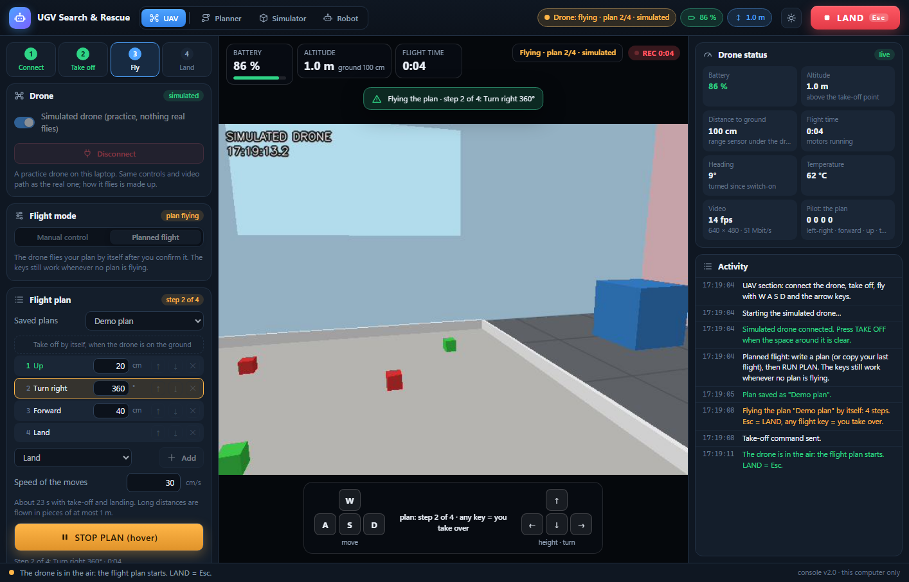

# UAV section: the Tello drone

The first button in the top bar. Fly a Tello from the laptop, watch its camera, see battery and altitude,
and keep the footage. It comes before the robot work: scout with the drone, then switch to the UGV modes.

Two flight modes:

- **Manual control**: you fly with the keys.
- **Planned flight**: the drone flies a list of steps by itself. You write the list, or it copies a flight
  you flew by hand.



> **Status.** Manual control has been flown with a real Tello (connect, live picture, take-off, keys, landing,
> footage saved). **Planned flight has only been flown with the built-in simulated drone so far.** Read
> [Before the first real planned flight](#before-the-first-real-planned-flight).

## Try it without a drone (2 minutes)

1. Top bar: **UAV**.
2. Switch **Simulated drone** on, press **Start simulated drone**. A picture of a drawn room appears.
3. Press **TAKE OFF** and confirm.
4. Hold **W A S D** and the **arrow keys**. Let go: it hovers.
5. **Esc** (or **LAND**) lands it. The flight video is saved by itself.

## Manual control: the keys

| Key | The drone |
|---|---|
| **W** / **S** | flies forward / back |
| **A** / **D** | flies left / right |
| **↑** / **↓** | goes up / down |
| **←** / **→** | turns left / right |
| **Esc** | lands |

- The drone moves only while a key is held. Several keys together work (for example W + →).
- **Stick strength** sets how hard a key pushes: *Gentle 20*, *Normal 35*, *Fast 60*. Start gentle.
- The keys on the picture can be pressed with the mouse too.
- Keys do nothing while you type in a text field or a dialog is open.

## Planned flight

Switch **Flight mode** to **Planned flight**. A *Flight plan* card appears.

### Write a plan

1. Choose a step (for example **Up**), type the number (**20**), press **Add**. Repeat.
2. Example: *Up 20 cm*, *Turn right 360°*, *Forward 40 cm*, *Land*.
3. Change a number in the list at any time. **↑ ↓** move a step, **✕** removes it.
4. Press **RUN PLAN**. The console shows the whole plan and asks. Confirm: the drone takes off and flies it.

| Step | What it does | Allowed |
|---|---|---|
| **Forward / Back / Left / Right / Up / Down** | flies that distance | 20 to 500 cm |
| **Turn right / Turn left** | turns on the spot | 1 to 360° |
| **Hover** | waits in the air | 0.2 to 120 s |
| **Photo** | saves a photo | |
| **Speed** | sets the speed of the moves that follow | 10 to 100 cm/s |
| **Land** | lands; always the last step | |

- **Take off** is not a step: the plan takes off by itself when the drone is on the ground. If the drone is
  already hovering, the plan starts from where it is.
- Without **Land** at the end the drone hovers when the plan is finished and you have the keys.
- **Speed of the moves** (30 cm/s to start with) is for the whole plan; a *Speed* step changes it on the way.
- Distances and turns are measured by the drone itself, so they are the exact part. A move longer than 1 m is
  flown in pieces of at most 1 m (it stops for a moment in between).
- A plan can have 200 steps.

### Copy a flight you flew by hand

1. Fly in **Manual control**: take off, fly with the keys, land.
2. The console remembers that flight as the plan **Last manual flight** (it says so in the Activity list).
3. **Planned flight** > **My last flight** loads it. The steps read like *Keys: forward at 35 % for 1.8 s*.
4. **RUN PLAN** flies it again. Photos you took are taken again at the same moments.

A copied flight repeats your **key presses with the same timing**. The drone does not know where it is, so it
ends up close to where you flew, not exactly there: drift, air movement and the battery level all change the
path a little. For exact distances write the steps yourself.

Every new manual flight replaces *Last manual flight*. To keep one, load it and **Save** it under its own name.

### Save, load, delete

- Type a name, press **Save**. Saved plans are in the list **Saved plans**: choose one to load it.
- **New** empties the plan, **Delete** removes the saved plan chosen in the list.
- The plan on the page is kept when you close the console.
- The files are in `data/uav_plans` (one small file per plan).

### Stopping a plan

| You do | The drone |
|---|---|
| **Esc** or **LAND** | lands |
| **STOP PLAN** | hovers, and the keys work again |
| press any flight key (W A S D, arrows) | hovers, and you are flying it |
| close the console page | hovers after 1.5 s, lands after 5 s |

A distance or turn that is already under way is finished first (at most one piece of 1 m): the drone only
answers when it has done a move. *Hover* and copied *Keys* steps stop at once. LAND is sent immediately and
repeated until the drone confirms.

The plan also stops by itself when the drone answers "error" to a step (the answer is shown), when a step is
not answered in time, when nothing is heard from the drone, and when the battery falls below 15 % (then it
lands).

## What you see

| Reading | Meaning |
|---|---|
| **Battery** | Percent. Yellow below 25 %, red below 20 % (no take-off and no plan below 20 %). |
| **Altitude** | Height above the take-off point. |
| **Distance to ground** | The range sensor under the drone. |
| **Flight time**, **Heading**, **Temperature** | As the drone reports them. |
| **Video** | Pictures per second and size of the camera stream. |
| **Sticks** | What is being sent right now: left-right, forward, up, turn (-100 to 100). |

## Fly the real Tello

1. Charge it, put the propeller guards on, choose a room with free space.
2. Switch the Tello on. On the laptop, join its Wi-Fi (the name starts with **TELLO-**).
3. Console: **UAV**, switch **Simulated drone** off, press **Connect**.
4. The first time, Windows asks about Python and the firewall: tick **Private and Public**, then *Allow*.
5. Check: battery shown, altitude 0.0 m, live picture.
6. **TAKE OFF**, read the question, confirm.
7. Fly. **Esc** or **LAND** brings it down.

The drone's Wi-Fi is not the robot's network. Switch the laptop back to the robot's network before you use
the **UGV** mode.

## Footage

- **Record every flight** (on by default): filming starts at take-off and the video is saved 2 seconds after
  the landing. Planned flights are filmed the same way.
- **Record** films by hand, also on the ground. **Photo** saves one picture.
- Everything goes to `Videos\UAV footage` (change it under *Folder*; **Open footage folder** shows it).
- Files: `flight_<date>_<time>.mp4` and `photo_<date>_<time>.jpg`. Full camera size, nothing drawn on it.
- A video that is still being written is called `..._recording.mp4`. If the console closes or crashes it is
  finished and saved anyway.

## Safety rules built in

- **Take-off and RUN PLAN need two steps**: the button, then a confirmation. Nothing starts the motors by itself.
- **LAND never waits**, works in every state and is repeated until the drone confirms. Esc lands too.
- **Let go = hover.** The laptop sends the stick values 20 times a second and sends zeros when no key is held.
- **Page not reporting its keys for 0.5 s**: hover. **Page gone for 5 s**: land. A plan stops after 1.5 s.
- **Nothing heard from the drone for 2.5 s**: sticks to zero. **For 5 s**: land is sent.
- **Console program closed or crashed while flying**: land is sent (by the console, or by its video helper).
- **One machine at a time**: no take-off while the robot drives, no robot AUTHORIZE while the drone flies,
  and the UAV section cannot be left while the drone is in the air.
- **The plan that flies is the plan you were shown**: changing it after the question cancels the question.
- **Cut motors (emergency)** asks first: the drone falls. Only for a drone that is caught or flying away.
- The Tello itself lands when it gets no command for 15 seconds (its own safety feature).
- Only messages from the drone's own address are accepted.

## Before the first real planned flight

Planned flight uses the drone's own movement commands (`up 20`, `cw 360`, `forward 40` ...) from the official
Tello SDK document. They have not been sent to a real Tello from this console yet. Start small:

1. Free space of at least 2 m around the drone, good light (the drone measures its movement with a camera
   that looks at the floor; on a dark or plain shiny floor it may answer "error" instead of moving).
2. First plan: **Up 20 cm**, **Land**. Then add one step at a time.
3. Keep a finger on **Esc**.

| To check | Why |
|---|---|
| **The drone answers each step** | The plan waits for the drone's "ok" after every move. If a step is shown as *no answer*, the plan stops and the drone hovers: tell me what the message said. |
| **Esc during a move** | Not known whether the drone lands in the middle of a move or after it. Either way it lands; the question is only how soon. |
| **A copied flight** | Expect the same shape of flight, a little off in position. Indoors, close to walls, leave room for that. |
| **Losing Wi-Fi during a plan** | The console can no longer reach the drone. By its own safety feature the Tello lands after 15 s without commands; what it does with a move that was under way is not known. Stay close. |

## If something does not work

| Problem | Fix |
|---|---|
| *"The drone did not answer"* | The laptop is not on the Tello's Wi-Fi, or the Tello is off. The message says which address the laptop is using. Windows sometimes jumps back to your normal Wi-Fi because the Tello's has no internet: join **TELLO-…** again. A brand-new Tello may first have to be started once with the official Tello app. |
| Connected, but no picture and/or no battery | Windows Firewall blocks Python: Windows Security > Firewall > *Allow an app* > Python > tick Private **and** Public. Reconnect. |
| *"Port 11111 / 8890 is used by another program"* | Close other Tello programs (and a second console). |
| Keys do nothing | Is the state *Flying*? Click the picture once. Are you typing in a text field? |
| No take-off | The hint under the button says why: battery below 20 %, no battery reading, robot moving. |
| RUN PLAN is grey | The note under it says why: plan empty, drone not connected, a key is held, battery below 20 %. |
| A step is refused when you add it | The number is outside what the drone can do (for example a distance below 20 cm). The message names the step. |
| The plan stops with the drone's "error" | Usually the floor camera cannot measure: more light, a floor with some pattern, not too high. |
| Picture freezes | Too far from the drone, or Wi-Fi interference. The console restarts the video by itself twice. |

## How it works (short)

```
 page (browser)  --keys held / the plan-->  console program  --"rc a b c d", "up 20", "land" (UDP 8889)-->  Tello
                 <--pictures--------------  video worker     <--H.264 video (UDP 11111)--------------------
                 <--readings--------------  console program  <--status text (UDP 8890)---------------------
```

- `uav/tello.py`: the link (text commands of the official Tello SDK 1.3, status, safety rules).
- `uav/plan.py`: what a plan is, saved plans, and the runner that flies a plan step by step.
- `uav/video.py`: a separate process that receives, decodes, previews and records the video.
- `uav/sim.py`: the simulated drone. It speaks the same protocol and sends real H.264 video, so the same
  code runs with it as with the real one. How it *flies* is made up.
- `ugv_console/uav_console.py`, `ugv_console/uav_plans.py` and `web/js/uav.js`: the commands and the page.
